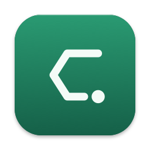
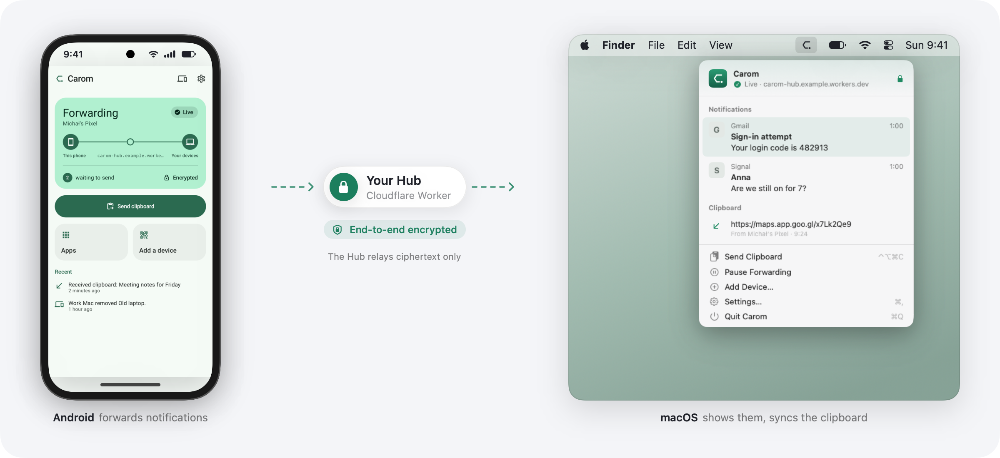
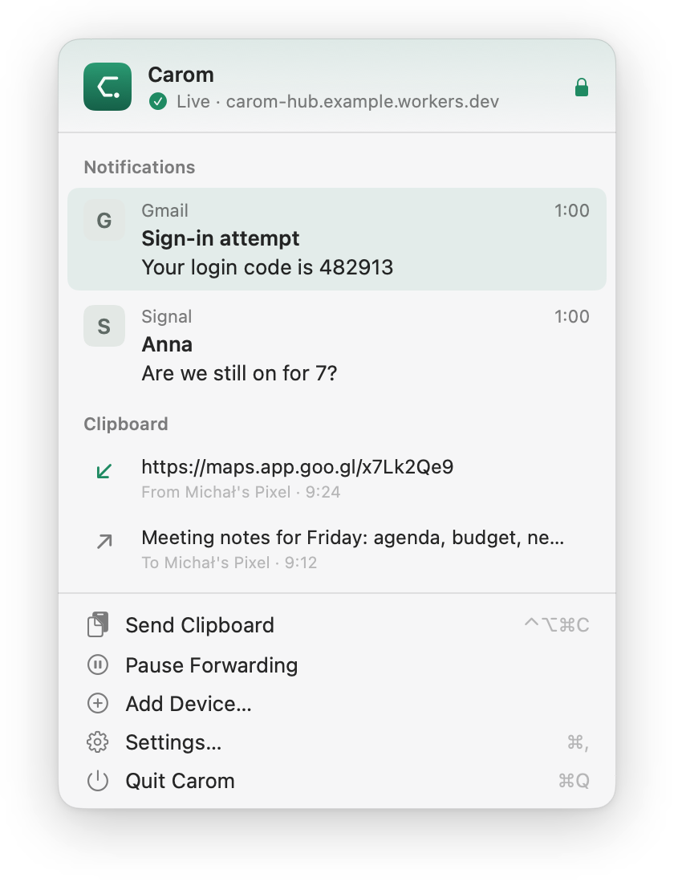
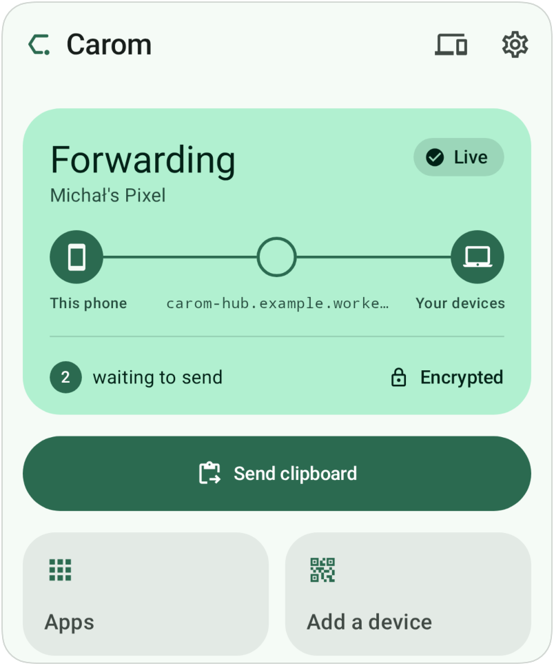
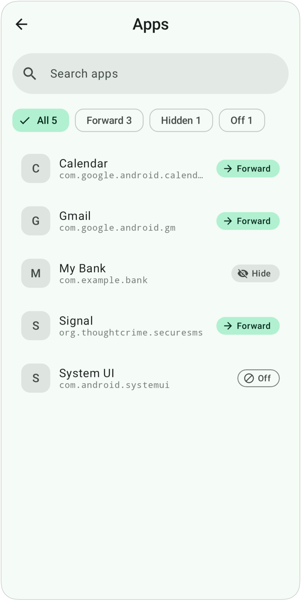
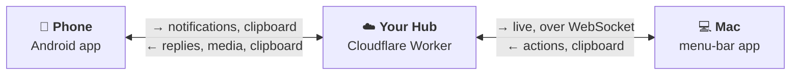
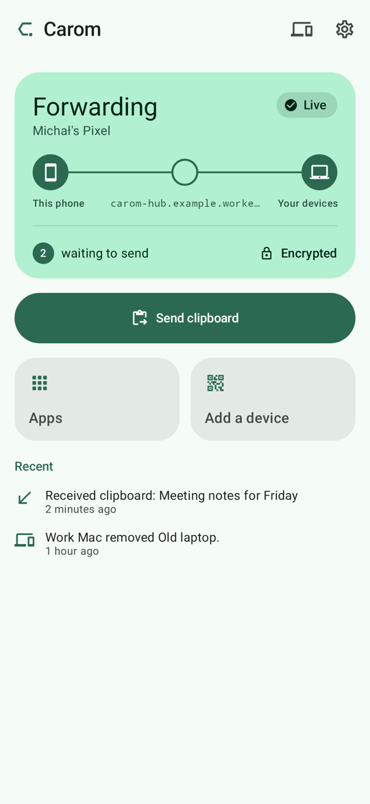
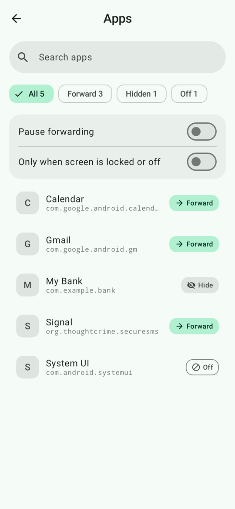
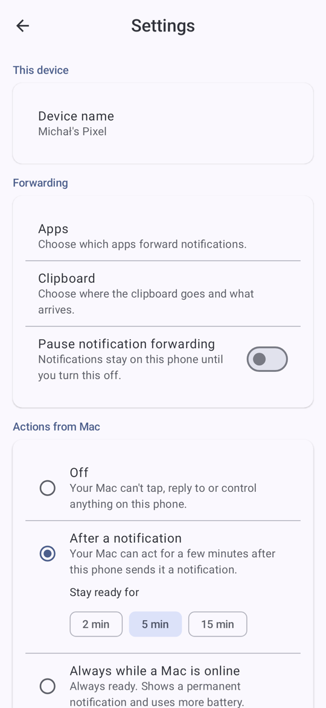
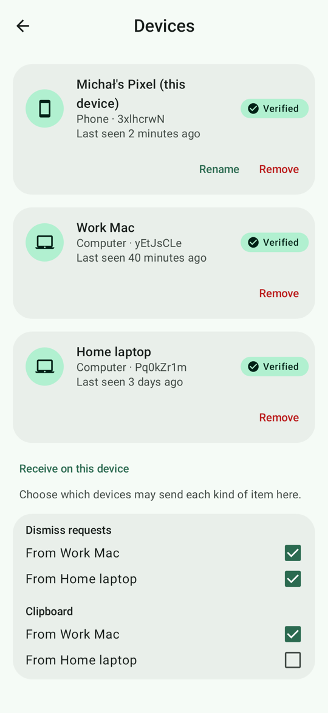

<p align="center">
  
</p>

<h1 align="center">Carom</h1>

<p align="center">
  <b>Your phone's notifications on your Mac.</b><br>
  End-to-end encrypted, open source, and running on your own Cloudflare account, for free.
</p>

<p align="center">
  <a href="LICENSE"></a>
  
  
  
</p>

<p align="center">
  
</p>

A message arrives on your phone and shows up on your Mac a moment later, so you can read it, copy the
login code or dismiss it without picking up the phone. Copy text on one device and send it to the
other. Think Pushbullet, but you own the server and nobody (including that server) can read your data.

## Why Carom

- 🔒 **Private by design.** Notifications and clipboard are encrypted on your phone and decrypted on
  your Mac. The server in between only ever sees ciphertext.
- ☁️ **Your server, zero maintenance.** One command deploys a tiny Hub to *your* Cloudflare account
  on the free plan. There's nothing to patch, back up or keep online.
- 🛡️ **No open ports, no LAN tricks.** Every device connects outward to your Hub, so it works on any
  network, home or not, and nothing on your devices listens for connections.
- 🔋 **Light on battery.** The phone does no polling and has no push connection. Carom wakes
  only when Android hands it a notification, or when you use it. After a notification it listens
  for your Mac for a few minutes, so replies and buttons are quick. You can shorten or turn this off.
- 🎛️ **You decide what's shared.** Forward, hide the content of, or block each app. Mute apps on the
  Mac. Pick which devices send and receive the clipboard.
- 📱💻 **Any number of devices.** Pair phones and Macs with a QR code. Remove a lost one from any
  other device, and the rest switch to a new key.

## Features

| | |
|---|---|
| **Rich notifications → Mac** | The whole notification, close to how it looks on the phone: app and large icons, colours, big pictures, conversations with avatars, inbox and progress styles, and grouped stacks. Removed on the phone means removed on the Mac. A quiet copy also goes to Notification Center, and Focus is respected |
| **Act from the Mac** | The app's own buttons, **Reply** inline (with suggested replies), **Dismiss on phone**, and **Copy text** |
| **Live Updates and progress** | Android 16 Live Updates, progress bars and timers update in place, with an optional menu-bar chip |
| **Media controls** | A Now Playing card with play/pause, previous, next and seek |
| **Calls** | An incoming-call card with **Answer** and **Decline**. Audio stays on the phone |
| **One-time codes** | 4 to 10 digit and letter-digit codes, a **Copy code** button, optional auto-copy that clears after 60 s, and a way through Android 15's code hiding |
| **Clipboard, both ways** | Phone → Mac with one tap (button, Quick Settings tile or share sheet). Mac → phone automatically, by hotkey (⌃⌥⌘C) or from the menu, waiting for you the next time you open Carom on the phone |
| **Per-app control** | Forward / Hide content / Off for each app, "only when locked", pause |
| **Simple pairing** | Scan a QR code and confirm a short code on both screens. The Hub can't intercept it |

<table>
  <tr>
    <td align="center"><br><sub>macOS menu-bar app</sub></td>
    <td align="center"><br><sub>Android app</sub></td>
    <td align="center"><br><sub>Per-app control</sub></td>
  </tr>
</table>

## How it works



1. **The phone** sees a notification, filters it by your rules, and encrypts and signs it for your other
   devices (Ed25519, X25519, ChaCha20-Poly1305).
2. **Your Hub** is one Cloudflare Worker and one SQLite Durable Object. It checks who is allowed to post,
   queues the opaque envelope, and fans it out. It never holds a key.
3. **The Mac** keeps a WebSocket to the Hub, verifies and decrypts, and shows the notification as a
   card, with its images fetched and decrypted separately.

Messages to the phone, such as a reply or a media command, wait at the Hub. Right after the phone
sends a notification, it opens a connection for a few minutes (the *action window*), so they arrive
at once. Outside the window they wait until you open Carom, and the Mac says the phone is asleep.

Keys are exchanged by QR code when you pair, and never leave your devices. The Hub stores messages
only until they're delivered (one or two days at most).

## Quick start

You need a free Cloudflare account, Node.js 22+, a Mac with macOS 14+, and an Android 10+ phone.

```sh
git clone https://github.com/tajchert/carom.git && cd carom
npm install
node hub/bin/carom-hub.mjs deploy      # logs in to Cloudflare, deploys, prints a setup QR code
```

1. **Mac:** open Carom → *Set Up a New Hub* → paste the `carom://setup…` link → *Add a Phone*.
2. **Phone:** open Carom → *Join with a code* → scan the QR code → grant notification access.
3. That's it. Your next notification appears on the Mac.

The **[setup guide](docs/SETUP.md)** walks through every step, permissions, daily use and troubleshooting.

Your Hub's URL is public. The Hub rate-limits strangers before they can cost anything, but a flood
from many addresses can still use up the Free plan's 100k daily requests. The Hub then pauses
until the next day, and your data stays safe ([details](hub/README.md#limits-and-cost)).

> **Early development.** There are no prebuilt app downloads yet, so build them from source (see the
> [setup guide](docs/SETUP.md#building-from-source)).

## The Android app

A modern, native Android app: 100% Kotlin and 100% Jetpack Compose with Material 3 (dynamic colour,
light and dark themes), and no XML layouts. It follows the recommended Android architecture:
unidirectional data flow with `StateFlow`-backed ViewModels, a single-activity Navigation 3 graph,
and a modular `core:*` + `feature:*:api/impl` split wired with Hilt. Room and DataStore keep the
state, WorkManager runs the background sends, and the protocol is pure Kotlin tested against the
shared vectors. Layouts adapt to phones, foldables and tablets, and every screen is covered by
Compose screenshot tests. The screenshots below are rendered straight from those tests.

<table>
  <tr>
    <td align="center"><br><sub>Home</sub></td>
    <td align="center"><br><sub>Per-app forwarding</sub></td>
    <td align="center"><br><sub>Settings</sub></td>
    <td align="center"><br><sub>Devices</sub></td>
  </tr>
</table>

## Built to grow

The apps and the Hub share one small, versioned protocol. The Hub only routes encrypted envelopes and
never looks at message types, so **new features are new message types and need no server change**.
Sending links, phone battery status, file transfer, a CLI, and Windows or Linux clients all fit the
existing design.

- **[Protocol spec](protocol/SPEC.md):** envelope, cryptography, pairing, rekeying, Hub API
- **Shared test vectors:** the TypeScript, Kotlin and Swift implementations, and the Hub, all pass
  the same vectors

## Repository

| Folder | What |
|---|---|
| [`hub/`](hub/) | Cloudflare Worker + Durable Object (TypeScript), and the `carom-hub` deploy CLI |
| [`android/`](android/) | Android app (Kotlin, Jetpack Compose) |
| [`macos/`](macos/) | macOS menu-bar app (SwiftUI) and the `CaromKit` package |
| [`protocol/`](protocol/) | Spec, JSON Schemas, test vectors, TypeScript reference implementation |
| [`docs/`](docs/) | [Setup guide](docs/SETUP.md), [client behaviour](docs/CLIENTS.md) |

## License

[GPL-3.0](LICENSE). Contributions welcome.
